<p align="center">
  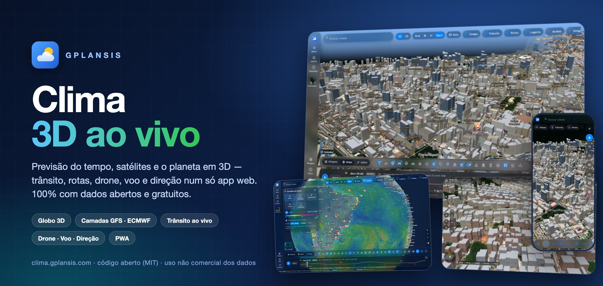
</p>

<h1 align="center">GPlanSiS Clima</h1>

<p align="center">
  <b>Previsão do tempo, satélites e o planeta em 3D, num só app web.</b><br>
  Globo 3D com prédios, relevo e mar · camadas GFS e ECMWF · trânsito ao vivo · rotas · drone · simulador de voo · direção<br>
  Feito só com dados abertos e gratuitos. Sem anúncios, sem cadastro, sem afiliados.
</p>

<p align="center">
  <a href="https://clima.gplansis.com"></a>
  <a href="LICENSE"></a>
  
  
  
</p>

---

## Sumário

- [Visão geral](#visão-geral)
- [Funcionalidades](#funcionalidades)
- [Telas](#telas)
- [Fontes de dados gratuitas](#fontes-de-dados-gratuitas)
- [Bibliotecas](#bibliotecas)
- [Arquitetura](#arquitetura)
- [Ferramentas de dados (`tools/`)](#ferramentas-de-dados-tools)
- [Rodar localmente](#rodar-localmente)
- [Publicar no servidor](#publicar-no-servidor)
- [Licenças](#licenças)

## Visão geral

O **GPlanSiS Clima** é um aplicativo web (PWA) que junta numa mesma tela:

- a previsão do tempo de qualquer lugar do mundo;
- as camadas meteorológicas globais (vento, chuva, raios, temperatura, ondas);
- um globo 3D com relevo, mar, prédios com altura medida e monumentos;
- trânsito em tempo real e rotas;
- modos de exploração: drone, simulador de voo e direção.

O front-end é JavaScript puro, sem framework nem etapa de build. Arquivos estáticos são servidos pelo Caddy, e alguns scripts Python geram as camadas pesadas no servidor: modelos meteorológicos e alturas dos prédios.

O projeto é **sem fins comerciais**. Todos os dados vêm de fontes abertas ou de camadas gratuitas, com atribuição. Os links de viagem são apenas buscas, sem afiliação.

## Funcionalidades

### 🌍 Mapa e globo 3D
- Globo e mapa com MapLibre GL, nos modos **3D/2D**:
  - fundo **Real** (satélite);
  - **IR** (infravermelho NASA);
  - **Ar** (qualidade do ar);
  - **Água** (mar e rios);
  - **Rota** (estilo de navegação com relevo).
- **Relevo** com sombreamento e curvas de nível. O **mar e os corpos d’água ficam planos**, com limpeza do DEM feita num worker.
- **Prédios 3D** em todo o mundo (Overture Maps), com **alturas medidas** para cerca de 200 áreas (≈ 2 milhões de prédios):
  - Google Open Buildings 2.5D;
  - GHSL;
  - Wikidata;
  - em Florianópolis, o **levantamento aéreo SIG-SC**, com cor real do telhado, fachadas e sombra de contato.
- **Monumentos 3D**: pirâmides de Gizé, torres e marcos, além de arranha-céus (Wikidata).
- **Clique no mapa → cartão do lugar** com:
  - tempo atual e altitude;
  - endereço (OSM);
  - ações: salvar, rota, previsão, drone daqui.
- **Menu de contexto** com clique direito ou toque longo.
- **Webcams ao vivo**: cerca de 200 transmissões abertas, como cartões de vídeo.
- Pontos de interesse:
  - aeroportos, rodoviárias, vulcões, templos e marcos;
  - **aviões ao vivo** (ADS-B);
  - **satélites Starlink** em órbita.
- **GPS ao vivo** com um único ponto suavizado, precisão e direção.

### 🌦️ Tempo e meteorologia
- **Previsão** por hora e por dia, com sensação térmica, UV, umidade, pressão, visibilidade, nascer e pôr do sol e fases da lua.
- **Camadas do tempo animadas**, com partículas de vento:
  - vento;
  - chuva e acumulado;
  - raios (CAPE);
  - temperatura;
  - ondas (altura, direção e período).
- **Dois modelos**: **NOAA GFS 0,25°** e **ECMWF IFS 0,25°**, processados de hora em hora no servidor.
- **Radar de chuva** (RainViewer) e **nuvens e infravermelho** (NASA GIBS).
- **Rosa dos ventos em tempo real**, **linha do tempo** com slider e atualização automática a cada **20 minutos**.
- **Comparação de modelos**, conjunto de previsões (ensemble) e histórico de 30 dias.
- **Qualidade do ar**, com coleta periódica no servidor.

### 🌊 Esportes e mar
- Painel de esportes com condições para surf, kitesurf, windsurf, vela, SUP, pesca e outros.
- **Modal avançado** combinando ondas, swell, vento, rajadas, maré e temperatura da água.

### 🚗 Trânsito e rotas
- **Trânsito ao vivo** (fluxo e incidentes) com **sincronização em tempo real** do mapa.
- **Widget de configuração**: linhas, chips, marcações e intensidade.
- **Rotas** de carro, bicicleta e a pé (Valhalla/OSM), com estilo de navegação e relevo.

### 🛸 Drone, voo e direção
- **Drone avançado**, com interface inspirada nos rádios de drones de consumo. Decola da sua localização ou de um ponto marcado no mapa. Inclui:
  - **gimbal 360°** e lentes;
  - joysticks virtuais e **retorno para casa (RTH)**;
  - **MasterShots** (órbita, hélice, foguete, revelação);
  - anel do alvo e rota 3D.
- **Tour aéreo livre** com câmeras cinematográficas.
- **Modo direção** em terceira pessoa, com câmera de perseguição e **colisão com prédios**.
- **Simulador de voo** sobre o terreno real.
- **Controles em tela de toque** iguais aos de um rádio de drone, nos três modos.

### 🧩 Interface
- Visual em vidro fosco (“liquid glass”), com tema claro e escuro, para web e celular.
- Barra lateral, chips de camadas e **widgets arrastáveis e recolhíveis** que nunca ficam sobrepostos.
- **Minha tela**: um painel montável.
- No celular, **gavetas com arraste** e botões verticais (3D, localização, globo).
- **Locais salvos** e **recentes**, menu unificado em todas as páginas.
- **PWA instalável**, com cache offline (service worker) e primeira pintura rápida.
- **Laboratório** com análises e gráficos (Chart.js) e páginas de especialistas e previsões.

## Telas

| | |
|:---:|:---:|
| 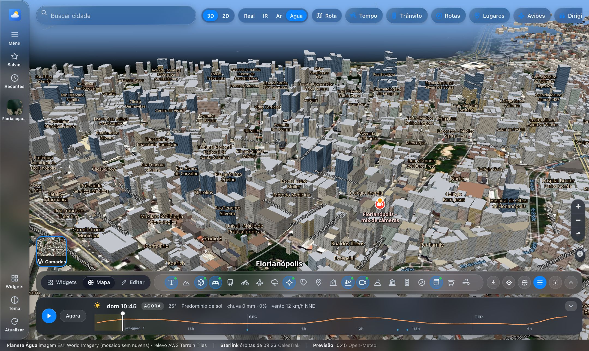<br>**Florianópolis em 3D:** alturas medidas (SIG-SC) e cor real do telhado | 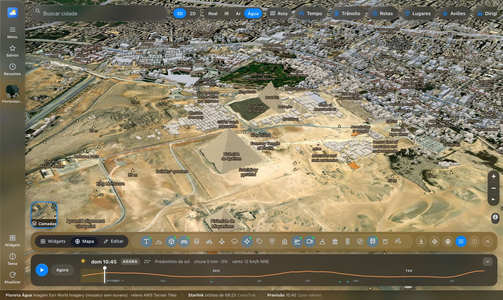<br>**Monumentos 3D:** pirâmides de Gizé |
| 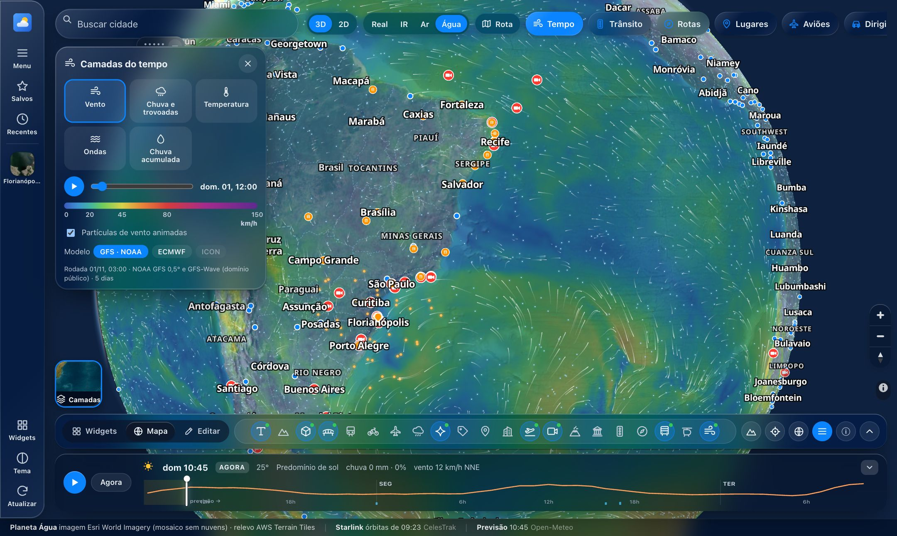<br>**Camadas do tempo:** vento animado GFS/ECMWF | 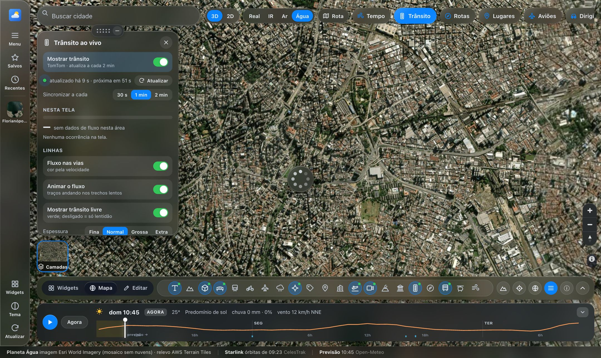<br>**Trânsito ao vivo**, com widget de configuração |
| 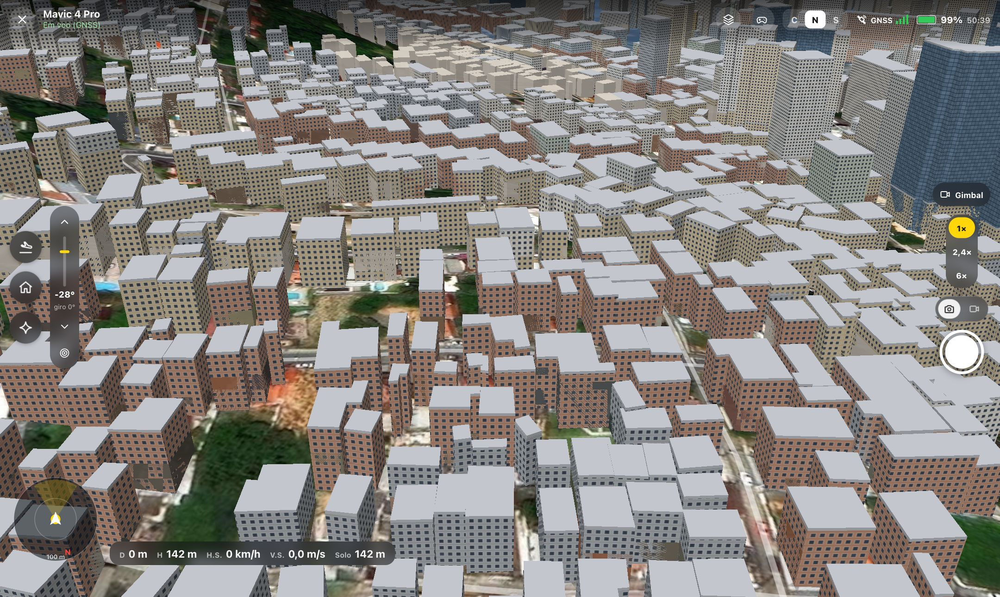<br>**Drone:** voo a 142 m sobre a Beira-Mar | 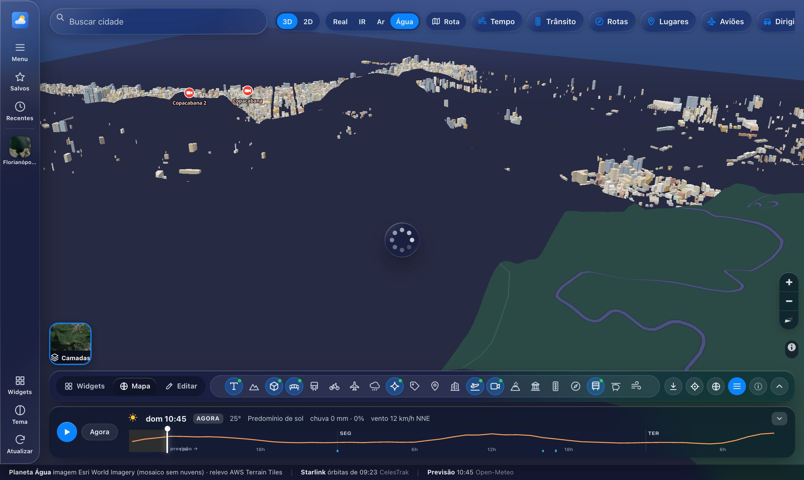<br>**Estilo Rota** com relevo e prédios |
| 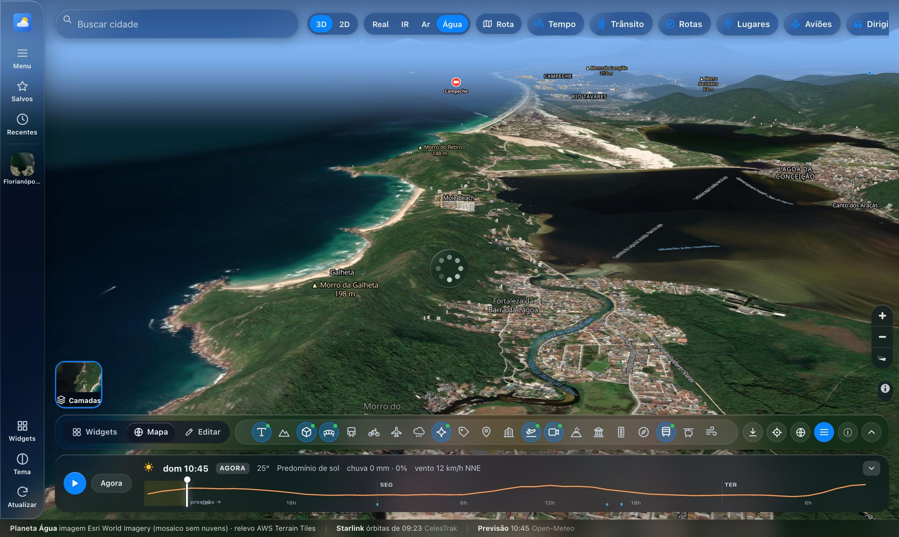<br>**Relevo** com mar e água planos | 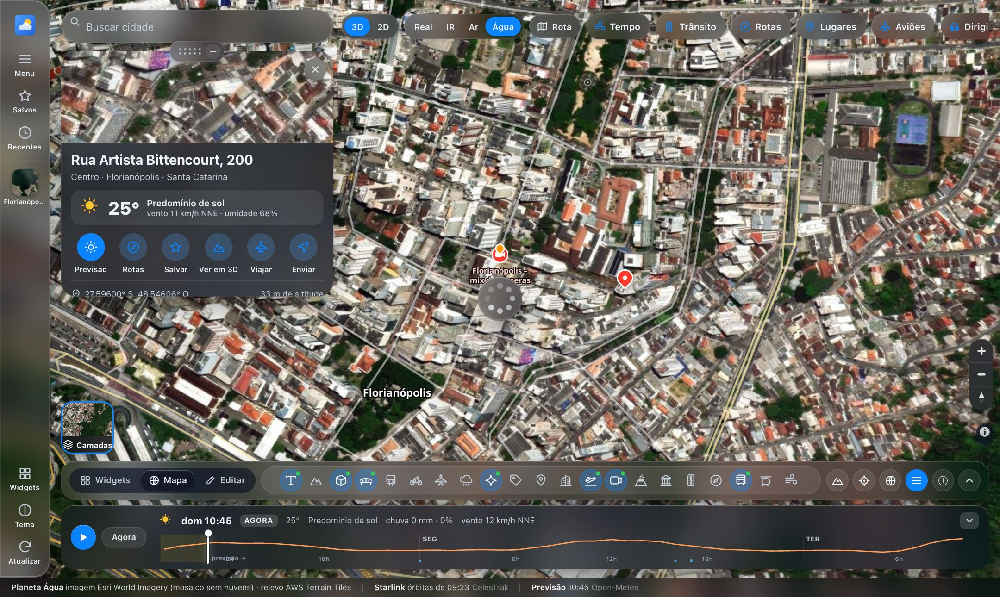<br>**Cartão do lugar** ao clicar no mapa |
| 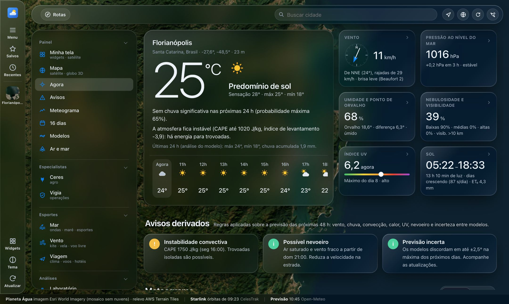<br>**Previsão:** agora, por hora e por dia | 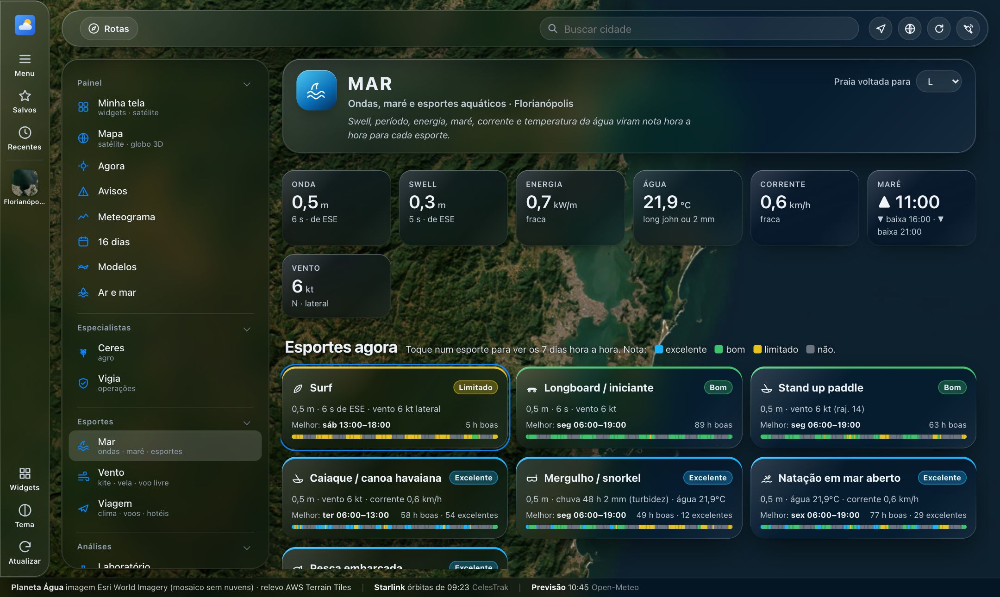<br>**Esportes e mar:** ondas e vento |
| 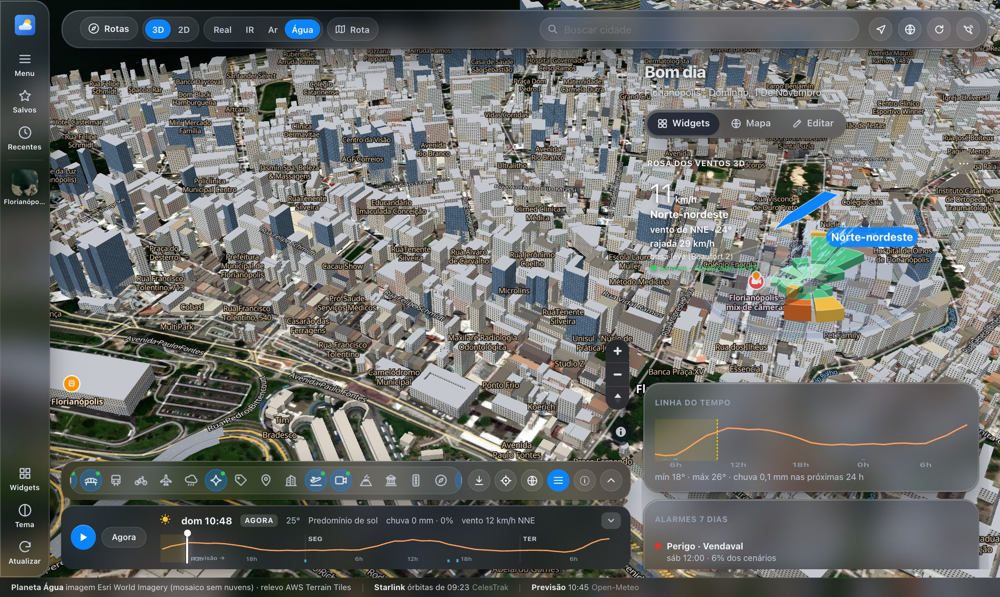<br>**Minha tela:** painel de widgets | 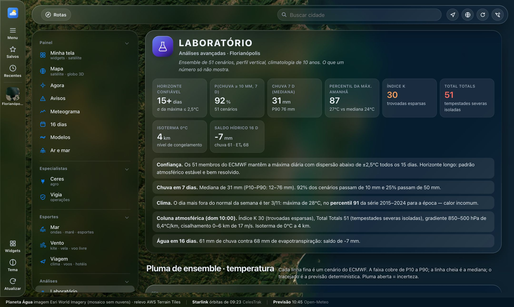<br>**Laboratório** de análises |

<p align="center">
  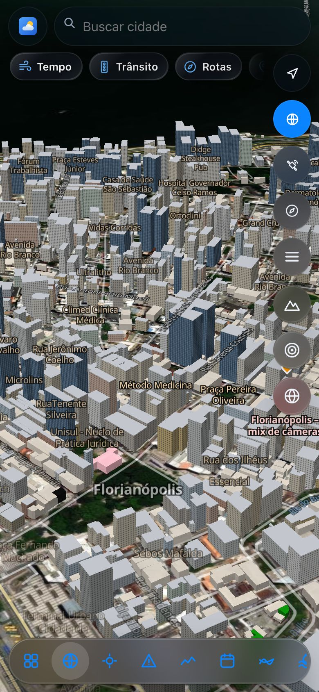<br>
  <b>Celular:</b> gavetas com arraste e botões verticais
</p>

## Fontes de dados gratuitas

Todos os dados abaixo são abertos ou de uso gratuito. A atribuição aparece no próprio mapa. Respeite os termos de cada fonte ao reutilizar.

### Tempo, mar e clima

| Fonte | Uso no app | Licença / termos |
|---|---|---|
| [Open-Meteo](https://open-meteo.com) (forecast, marine, ensemble, archive, air quality, geocoding) | Previsão, ondas, conjunto de previsões, histórico, ar, busca de cidades | Dados **CC BY 4.0**; API gratuita para uso não comercial |
| [NOAA GFS e GFS-Wave](https://registry.opendata.aws/noaa-gfs-bdp-pds/) (NOAA Open Data, AWS) | Camadas de vento, chuva, CAPE, temperatura e ondas | **Domínio público** (governo dos EUA) |
| [ECMWF Open Data](https://www.ecmwf.int/en/forecasts/datasets/open-data), IFS e WAM 0,25° | Mesmas camadas pelo modelo europeu | **CC BY 4.0** |
| [RainViewer](https://www.rainviewer.com/api.html) | Radar de chuva | API gratuita, com atribuição |
| [NASA GIBS / Worldview](https://www.earthdata.nasa.gov/engage/open-data-services-software/earthdata-developer-portal/gibs-api) | Nuvens, infravermelho, imagens diárias | Dados abertos da NASA, sem restrição de uso, com atribuição |

### Mapas, relevo e prédios

| Fonte | Uso no app | Licença / termos |
|---|---|---|
| [OpenStreetMap](https://www.openstreetmap.org/copyright) via [OpenFreeMap](https://openfreemap.org) | Mapa vetorial base | **ODbL** (dados), schema OpenMapTiles |
| [Overture Maps](https://overturemaps.org) (PMTiles) | Contornos de prédios no mundo todo | Tema *buildings*: **ODbL** |
| [Esri World Imagery](https://www.arcgis.com/home/item.html?id=10df2279f9684e4a9f6a7f08febac2a9) | Fundo de satélite “Real” | Termos de uso da Esri, com atribuição (Esri, Maxar, Earthstar Geographics e comunidade GIS) |
| [AWS Terrain Tiles](https://registry.opendata.aws/terrain-tiles/) (Mapzen, Terrarium) | Relevo 3D, sombreamento, curvas | Gratuito; [atribuições das fontes](https://github.com/tilezen/joerd/blob/master/docs/attribution.md) (SRTM, GMTED, ETOPO1 etc.) |
| [Google Open Buildings 2.5D Temporal](https://sites.research.google/open-buildings/) | Alturas medidas de prédios (Sul Global) | **CC BY 4.0** |
| [GHSL — JRC/Comissão Europeia](https://human-settlement.emergency.copernicus.eu/) | Altura média construída (onde faltam medições) | **CC BY 4.0** |
| [SIG-SC — Governo de Santa Catarina](https://sigsc.sc.gov.br) | Florianópolis: MDS/MDT e ortofoto 2010–2012, para alturas, cor de telhado e prédios não mapeados | Dado público estadual, citando a fonte |
| [CyclOSM](https://www.cyclosm.org) / [OpenRailwayMap](https://www.openrailwaymap.org) | Camadas de ciclovias e ferrovias | Dados ODbL; tiles **CC BY-SA** |

### Lugares, rotas e pontos de interesse

| Fonte | Uso no app | Licença / termos |
|---|---|---|
| [Nominatim (OSM)](https://operations.osmfoundation.org/policies/nominatim/) | Endereço do ponto clicado e busca | ODbL, com política de uso (1 req/s) |
| [Valhalla — FOSSGIS](https://valhalla1.openstreetmap.de) | Cálculo de rotas | Serviço público com uso justo; dados ODbL |
| [BigDataCloud](https://www.bigdatacloud.com/free-api/free-reverse-geocode-to-city-api) | Nome da cidade pela localização | API gratuita no cliente |
| [Wikidata](https://www.wikidata.org) / [Wikimedia Commons](https://commons.wikimedia.org) / Wikipedia | Arranha-céus, monumentos, templos, alturas, fotos e resumos | Wikidata **CC0**; textos **CC BY-SA**; imagens com licença por arquivo |
| [OurAirports](https://ourairports.com/data/) | Aeroportos | **Domínio público** |
| [Smithsonian GVP](https://volcano.si.edu) | Vulcões do Holoceno | Uso livre com citação do Global Volcanism Program |
| Rodoviárias | Terminais rodoviários | Extraídos do OpenStreetMap (ODbL) |

### Tempo real

| Fonte | Uso no app | Licença / termos |
|---|---|---|
| [adsb.lol](https://www.adsb.lol) | Aviões ao vivo (ADS-B) | **ODbL** |
| [adsbdb](https://www.adsbdb.com) / [OpenSky Network](https://opensky-network.org) | Rota e dados da aeronave | APIs gratuitas; OpenSky para uso não comercial e pesquisa |
| [CelesTrak](https://celestrak.org) | Órbitas Starlink (TLE/GP), atualizadas a cada 2 h | Dados públicos e gratuitos |
| [TomTom Traffic](https://developer.tomtom.com) | Fluxo e incidentes de trânsito | Camada gratuita; **a chave fica só no servidor** (proxy Caddy), nunca no código |
| YouTube (embed sem cookies) | Webcams ao vivo | Termos do YouTube; só transmissões públicas incorporáveis |

> Os links de viagem (hotéis, voos, carros) são **apenas buscas** em sites públicos, sem afiliação nem comissão.

## Bibliotecas

As bibliotecas ficam em `public/vendor/`, sem CDN e sem build.

| Biblioteca | Versão | Licença |
|---|---|---|
| [MapLibre GL JS](https://github.com/maplibre/maplibre-gl-js) | 5.x | BSD-3-Clause |
| [PMTiles](https://github.com/protomaps/PMTiles) | 3.x | BSD-3-Clause |
| [maplibre-contour](https://github.com/onthegomap/maplibre-contour) | — | BSD-3-Clause |
| [Chart.js](https://github.com/chartjs/Chart.js) | 4.4.1 | MIT |
| [satellite.js](https://github.com/shashwatak/satellite-js) | — | MIT |

No servidor e nas ferramentas, o projeto usa Python 3 com:

- NumPy (BSD);
- SciPy (BSD);
- Pillow (MIT-CMU);
- pyproj (MIT);
- ecCodes (Apache-2.0);
- puppeteer-core (Apache-2.0), apenas para capturas de tela.

## Arquitetura

```
navegador (PWA, JS puro)                         servidor (Caddy, arquivos estáticos)
┌──────────────────────────────┐                 ┌─────────────────────────────────────────┐
│ index.html + app.css         │  ── HTTPS ──►   │ /opt/clima/public   → este public/      │
│ sat.js     mapa/globo 3D     │                 │ /opt/clima/data     → /data/* (meteo,   │
│ layout.js  barra, widgets    │                 │                       alturas, starlink)│
│ meteo.js   camadas GFS/ECMWF │                 │ proxy /tt/*  → TomTom (chave no Caddy)  │
│ roofs3d.js monumentos 3D     │                 │                                         │
│ drone.js / drive.js / ...    │                 │ cron: GFS :17 · ECMWF :37 · ar 5 min ·  │
│ sw.js      cache offline     │                 │       Starlink 2 h                      │
└──────────────────────────────┘                 └─────────────────────────────────────────┘
        │ APIs abertas direto do navegador (Open-Meteo, OSM, NASA, RainViewer, ADS-B…)
```

As camadas do tempo usam um formato próprio e enxuto. Cada hora do modelo vira **PNGs de dados** de 720 × 361 (grade de 0,5°):

| Arquivo | R | G | B |
|---|---|---|---|
| `a` | vento u | vento v | temperatura |
| `b` | chuva (taxa) | acumulado | CAPE |
| `w` | ondas: altura | direção | período |

O navegador decodifica os PNGs e desenha campos e partículas na GPU.

### Estrutura

```
public/            o app (servido como está)
  index.html, app.css, app.js       casca, estilos e núcleo
  sat.js                            mapa/globo, fundos, relevo, prédios, camadas
  layout.js, boot.js, menu.js       barra lateral, widgets, gavetas, menu de contexto
  meteo.js, wind3d.js, timeline.js  camadas do tempo, partículas, linha do tempo
  home.js, experts.js, pred.js, lab.js, sports.js, travel.js   páginas
  routes.js                         trânsito ao vivo e rotas
  drone.js, drive.js, flightsim.js, joy.js   drone, direção, voo, joysticks
  roofs3d.js, bridges3d.js          monumentos, pirâmides e pontes 3D
  gps.js, places.js, geo.js         GPS, locais salvos, geocodificação
  webcams.js                        câmeras ao vivo
  starlink-worker.js, sw.js         órbitas em worker; service worker
  data-*.json                       aeroportos, vulcões, templos, marcos, webcams
  data-heights/index.json           índice das áreas com alturas medidas
  vendor/                           MapLibre, PMTiles, Chart.js, satellite.js…
tools/             geração de dados (Python/Bash)
deploy/            Caddy, crons, coletores e script de envio
docs/              capa e capturas de tela do README
analise-clima.html página avulsa de análise meteorológica
```

## Ferramentas de dados (`tools/`)

| Script | O que faz |
|---|---|
| `meteo_gfs.py` | Baixa só os campos necessários do GFS e GFS-Wave (por *byte range* via `.idx`) e grava os PNGs de dados |
| `meteo_ecmwf.py` | O mesmo para o ECMWF IFS e WAM (dados abertos, via `.index`) |
| `alturas.py` | Alturas de prédios: Overture e Google Open Buildings 2.5D, lidos por HTTP Range sem baixar os rasters inteiros |
| `alturas_sigsc.py` | Florianópolis: altura pelo MDS − MDT do SIG-SC (WMS), cor do telhado pela ortofoto, filtros contra árvores e encostas |
| `predios_sigsc.py` | Detecta prédios que existem, mas não estão mapeados, pelo modelo de superfície. Usa filtros rígidos para **não criar prédios inexistentes** |
| `alturas_wikidata.py`, `ghsl_tiles.py` | Alturas por Wikidata e altura média do GHSL |
| `webcams_busca.py` | Busca e valida webcams ao vivo abertas para incorporação |
| `rodoviarias*.py` | Terminais rodoviários a partir do OSM |
| `fila*.sh`, `capitais_mundo.sh`, `alturas_lote.sh` | Filas de processamento de cidades (em paralelo) |
| `publicar_alturas.sh` | Envia só os arquivos de alturas ao servidor |
| `pesquisa.py` | Opcional: pesquisa assistida via API Gemini; a chave fica em `tools/.env`, fora do git |

Os arquivos de alturas (`public/data-heights/*.geojson`, cerca de 700 MB) **não ficam no git**. São gerados pelos scripts e publicados direto no servidor.

## Rodar localmente

Não há build. Basta servir a pasta `public/`:

```bash
cd public
python3 -m http.server 8080
# abra http://localhost:8080
```

Sem o servidor de dados, as camadas GFS/ECMWF, as alturas medidas, o trânsito TomTom e o Starlink ficam indisponíveis. Todo o resto funciona direto pelas APIs abertas.

Para gerar as camadas do tempo localmente:

```bash
python3 -m venv venv && venv/bin/pip install numpy pillow eccodes
venv/bin/python tools/meteo_gfs.py   ./data/meteo/gfs
venv/bin/python tools/meteo_ecmwf.py ./data/meteo/ecmwf
```

## Publicar no servidor

```bash
echo "usuario@seu-servidor" > deploy/.vps     # fora do git
bash deploy/enviar.sh                         # envia public/ e recarrega o Caddy
```

- `deploy/clima.caddy`: site, cabeçalhos, cache e `/data/*`.
- O proxy do TomTom com a chave fica em `deploy/clima-tomtom.caddy`, **local e fora do git**.
- `deploy/*.cron`: GFS, ECMWF, qualidade do ar e Starlink.
- A cada versão, aumente `V` em `public/sw.js` para os navegadores trocarem o cache.

## Licenças

- **Código** deste repositório: [MIT](LICENSE) © 2026 Stefano Bianchi (GPlanSiS).
- **Bibliotecas** em `public/vendor/`: licenças próprias (BSD-3-Clause e MIT, veja [Bibliotecas](#bibliotecas)).
- **Dados**: cada fonte tem a sua licença (veja [Fontes de dados gratuitas](#fontes-de-dados-gratuitas)).
  - A licença MIT **não** se aplica aos dados de terceiros.
  - Ao reutilizar, mantenha as atribuições, por exemplo: © OpenStreetMap contributors, Open-Meteo (CC BY 4.0), ECMWF (CC BY 4.0), NOAA, NASA GIBS, Esri, Google Open Buildings (CC BY 4.0), JRC GHSL (CC BY 4.0), Governo de SC / SIG-SC.
- Alguns serviços (Open-Meteo gratuito, OpenSky, Nominatim, Valhalla FOSSGIS) permitem **apenas uso não comercial** ou têm limites de uso. Para uso comercial, contrate os planos pagos de cada provedor.

<p align="center"><sub>Feito em Florianópolis · <a href="https://clima.gplansis.com">clima.gplansis.com</a></sub></p>
